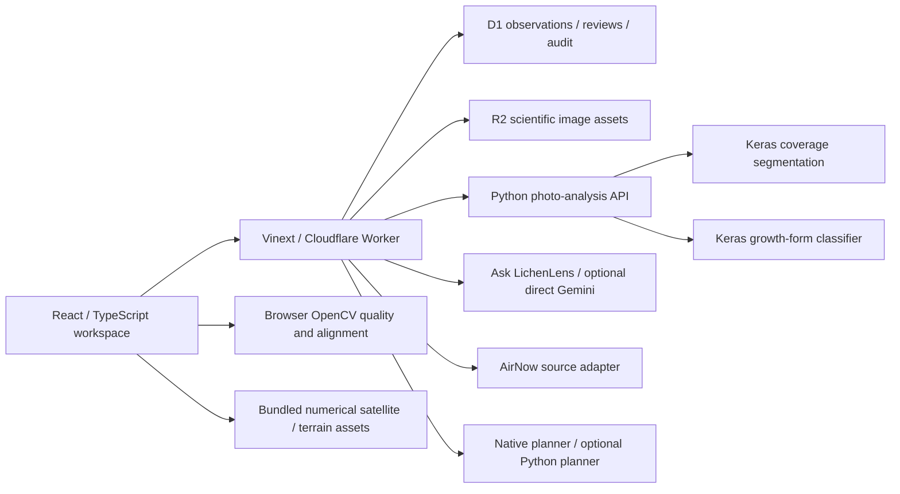

# EcoSignal

**Photograph lichens. Connect environmental context. Review the evidence. Plan the next observation.**

EcoSignal is an environmental observation and research application built for the Congressional App Challenge by Rhishi Dhinakaran. It brings together lichen computer vision, satellite indices, nearby air-quality readings, numerical terrain susceptibility, evidence review, adaptive sampling and a grounded AI assistant in one workspace.

This repository contains the latest website, the recovered photo-analysis service, research/training notebooks, model metadata, scientific limitations and the code supporting the features below. It is a technical showcase and source distribution. The existing website stays on its existing host.

**[Open EcoSignal](https://ecosignal-app.dhina-srini.chatgpt.site/)** · [Feature implementation guide](docs/FEATURES.md) · [Training records](docs/TRAINING_RECORDS.md) · [Related backend repositories](docs/RELATED_REPOSITORIES.md)

> Website source: v39, exported October 26, 2026, original source commit `e91366006e0f3a20992163d41eea143abaa75ef9`. This identifies the supplied website revision, not the later GitHub showcase commit. [Source verification](docs/V39_SOURCE_VERIFICATION.json).

## How the app works

1. Upload a photograph and check its capture quality.
2. Run the coverage and growth-form models; inspect their results, masks and review warnings.
3. Supply the observation's real site, coordinates and capture time. Attach available satellite, AirNow and terrain context.
4. Inspect the unified indicator and its source/completeness gates; save or export the observation.
5. Review predictions, propose corrections, create reviewed datasets, compare repeated captures and plan field missions.
6. Ask LichenLens a question, choosing exactly which observation fields and photograph to send.

The app keeps **model predictions, human corrections, data-quality diagnostics and environmental context distinguishable**. A model output is not automatically an approved label or an environmental conclusion.

**Supporting Repositories**

EcoSignal is an integrated environmental screening application supported by several independently developed components. The following repositories contain the source code, model development, and backend implementations.

Ask-Lichen-Lens: Used to host the Gemini API used for the AI Chatbot through Render
https://github.com/rhishidhina-blip/ecosignal_ask_lichen-lens

Photo-Analysis: Used to host computer vision models for app demonstration locally
https://github.com/rhishidhina-blip/ecosignal-photo-analysis

Active Sampling PLanner: Used to host the adaptive planner through Render
https://github.com/rhishidhina-blip/ecosignal-active-sampling-planner

**Personal Statement**
EcoSignal originally started out as LichenLens, which included just the computer vision models to detect lichen growth form and coverage. Over time, this app has developed into something that combines multiple different features, and has expanded from my initial vision. I faced many technical difficulties throughout the creation of this app, and I learned many skills throughout the creation of EcoSignal. I learned a lot from competing in the Congressional App Challenge, and value the opportunity.

## Features and supporting code

### LichenLens and observations

| Feature | Behavior | Main implementation |
|---|---|---|
| Photo capture/upload | Select a real photograph, prepare its observation and request the configured inference backend. | [Scan and result UI](app/page.tsx), [preparation](app/lib/prepare-observation.ts), [request proxy](app/lib/photo-analysis-proxy.ts) |
| Lichen coverage | MobileNetV2 U-Net predicts a probability mask; the active adapter thresholds at 0.65 and measures whole-photo coverage on the native 320×320 grid. | [Coverage adapter](services/photo-analysis/api/coverage.py), [mask diagnostics](services/photo-analysis/api/coverage_quality.py) |
| Growth-form classification | EfficientNet predicts crustose, foliose or fruticose with class probabilities and accepted/tentative/retake decisions. | [Growth adapter](services/photo-analysis/api/growth.py) |
| Mask and overlay display | Inspect highlighted areas alongside the original image, predicted coverage and review reasons. | [Result normalization](app/lib/photo-analysis.ts), [application UI](app/page.tsx) |
| Image quality and guided capture | Check resolution, sharpness, brightness, contrast and exposure; provide specific retake guidance. Accepted masks can add framing checks. | [Image algorithms](app/lib/image-evidence.ts), [capture coach](app/capture-coach.tsx) |
| Partial/error results | Preserve a usable model result if another fails; distinguish service failures, rejected predictions and review-required outputs. | [Photo API](services/photo-analysis/api/main.py), [proxy](app/lib/photo-analysis-proxy.ts) |
| Context entry | Retain site ID, coordinates, capture date/time and source/model versions; require explicit confirmations. | [Observation UI](app/page.tsx), [scoring validation](app/lib/unified.ts) |
| Local observation collection | Save and inspect browser observations, source values, image attachments and review status. | [Device storage helpers](app/lib/device-observations.ts), [observation image handling](app/lib/observation-image.ts), [application UI](app/page.tsx) |
| Import and export | Import model-result JSON; export observation JSON, CSV, a dataset snapshot and eligible site-input files. | [Application UI](app/page.tsx), [site export](app/lib/site-export.ts) |
| Device reset | Confirm deletion of this device's saved observation list; durable research originals are separate. | [Reset helpers and tests](app/lib/device-observations.ts), [UI](app/page.tsx) |
| Local correction/evaluation tools | Propose corrections, inspect review queues and coverage evaluation, and compare available model-version results. | [Application workspace](app/page.tsx), [durable evidence tools](app/evidence-workspace.tsx) |

Coverage measures the visible fraction of the **entire analyzed photograph**, not automatically the percentage of a separately segmented bark surface. Quality/confidence heuristics are not calibrated accuracy percentages.

### Environmental context and unified score

| Feature | Behavior | Main implementation |
|---|---|---|
| Satellite map | Select indices, compare dated source periods and inspect spatial layers. | [Satellite map](app/satellite-map.tsx), [raster overlay](app/raster-overlay.tsx), [satellite source adapter](app/lib/satellite.ts) |
| NDVI, NDMI, BSI and MNDWI | Show vegetation, moisture, bare-soil and water-related context with recorded source dates. | [Bundled source metadata](app/lib/satellite-data.json), [processing script](scripts/prepare-satellite.py) |
| Coordinate sampling | Sample a 3×3 patch from native 20m satellite data at confirmed coordinates; preserve valid pixels and clear-observation counts. | [Native sampler](app/lib/unified-satellite.ts), [preparation](scripts/prepare-unified-satellite.py) |
| Air-quality section | Show nearby AirNow AQI, category, pollutants, reporting details and location selection. | [Air-quality panel](app/air-quality-panel.tsx), [source adapter](app/lib/air-quality.ts) |
| Bounded AQI retry | Retry transient reading failures once, with unavailable states rather than invented data. | [Client request](app/lib/air-quality-client.ts) |
| Coordinate-based score attachment | Load air-quality context for an observation's coordinates and check alignment with its capture time. | [Unified AQI helper](app/lib/unified-air.ts), [unified panel](app/unified-panel.tsx) |
| Numerical GeoRisk | Sample the verified 2024 numerical terrain lattice, retaining grid/model/reference provenance. | [Numerical sampler](app/lib/georisk-numeric.ts), [manifest](app/data/georisk-numeric-manifest.json), [fixed CDF](app/data/georisk-reference-cdf.json) |
| Terrain map | Display the susceptibility overlay and its geographic coverage. | [GeoRisk map](app/georisk-map.tsx), [metadata](app/lib/georisk-metadata.json) |
| 3D Terrain Observatory | Explore bundled terrain geometry and time-related visualizations with source information. | [Observatory](app/terrain-observatory.tsx), [terrain component](app/ecosignal-terrain.tsx), [viewer assets](public) |
| Unified indicator | Combine eligible satellite (35%), AirNow (15%), visible lichen coverage (25%) and terrain (25%) components. | [Pure scoring engine](app/lib/unified.ts), [panel](app/unified-panel.tsx) |
| Completeness/provenance gates | Require all four weighted domains for a full score; reject missing, stale, illustrative, unconfirmed or geographically ineligible inputs. | [Scoring engine](app/lib/unified.ts), [production validation guide](docs/unified/PRODUCTION_VALIDATION.md) |
| Score scale | Display 0–100 relative concern with lower/middle/higher anchors and an accessible meter. | [Scale component](app/unified-score-scale.tsx) |
| Reproducible validation export | Export eligible unique-site inputs and run the production scoring logic locally, with optional historical as-of time. | [Exporter](app/lib/site-export.ts), [validation runner](scripts/validate-site-export.mjs) |

Growth form is **unweighted context**. MNDWI is water context rather than an additional weighted satellite term. The colored scale has **no validated environmental-health categories**. Terrain is sampled on a declared 20m lattice generated from native terrain features; it is not an arbitrary-location exact 1m prediction. Historical terrain and exploratory future-looking visualizations are not a validated forecast.

### Evidence and research workspace: all 19 implemented workflows

These workflows port the original research concepts into the existing D1/R2 and browser runtime. Detailed behavior, constraints and tests are documented in [the evidence integration guide](docs/features/INTEGRATION.md).

| # | Feature | What it does | Supporting code |
|---:|---|---|---|
| 1 | Durable observations and outputs | Store authenticated observations and separate immutable predictions. | [Evidence API](app/lib/evidence-api.ts), [store](app/lib/evidence-store.ts) |
| 2 | Scientific image assets | Store originals/derived assets with SHA-256, deduplication and lineage; authenticate retrieval. | [Asset API](app/lib/evidence-api.ts), [workspace UI](app/evidence-workspace.tsx) |
| 3 | Inference boundary | Call the actual external model service and record versions, statuses and outputs. | [Proxy](app/lib/photo-analysis-proxy.ts), [workspace pipeline](app/lib/evidence-api.ts) |
| 4 | Structured corrections | Propose coverage, growth-form or corrected-mask changes with evidence; allow withdrawal without editing originals. | [Correction rules](app/lib/evidence-core.ts), [API](app/lib/evidence-api.ts) |
| 5 | Independent review and staging | Reject self-review/duplicate votes; require two independent mask approvals before reviewed staging. | [Review rules](app/lib/evidence-core.ts), [API](app/lib/evidence-api.ts) |
| 6 | Dataset versions | Build explicit train/validation/test assignments; freeze checksummed manifests and guard site groups across splits/versions. | [Dataset API](app/lib/evidence-api.ts), [rules](app/lib/evidence-core.ts) |
| 7 | Reviewed dataset exports | Export frozen reviewed JSON, CSV, GeoJSON and bounded ZIP collections with images/masks and hashes. | [Export API](app/lib/evidence-api.ts) |
| 8 | Provenance and audit | Record server actors, per-run steps and file hashes in a verifiable audit chain. | [Evidence store](app/lib/evidence-store.ts) |
| 9 | Failure reporting | Return standardized failure codes/messages and request IDs while masking private service details. | [Evidence core](app/lib/evidence-core.ts), [API](app/lib/evidence-api.ts) |
| 10 | Model registry | Record model-card fields, artifact hashes, lifecycle and reviewed-data/validation prerequisites. | [Registry API](app/lib/evidence-api.ts), [registry UI](app/evidence-workspace.tsx) |
| 11 | Learning queues | Track missing outputs, reported uncertainty and geospatial gaps with stable queue state; no automatic retraining. | [Evidence API](app/lib/evidence-api.ts) |
| 12 | Reviewer dashboard | Filter by model/type/confidence/site/date/status and record authorized independent decisions. | [Workspace UI](app/evidence-workspace.tsx) |
| 13 | Reanalysis and comparison | Create new immutable runs; compare predictions for the same observation/model type. | [Pipeline API](app/lib/evidence-api.ts), [workspace UI](app/evidence-workspace.tsx) |
| 14 | Quality gate | Measure photograph quality, record thresholds and block unacceptable captures. | [OpenCV algorithms](app/lib/image-evidence.ts), [pipeline](app/lib/evidence-api.ts) |
| 15 | Analysis pipeline | Link quality checks, model inference, saved steps and available environmental context with explicit partial states. | [Preparation](app/lib/prepare-observation.ts), [API](app/lib/evidence-api.ts) |
| 16 | Confidence/quality components | Show known/missing components, weights and a labeled uncalibrated quality index. | [Aggregation](app/lib/evidence-core.ts), [workspace UI](app/evidence-workspace.tsx) |
| 17 | Field missions | Rank real candidate pools, deduplicate active missions, claim work, complete checklists and confirm sampled sites. | [Local planner](app/lib/planner-local.ts), [planner UI](app/adaptive-planner.tsx), [mission API](app/lib/evidence-api.ts) |
| 18 | Repeat monitoring | Compare explicitly confirmed same-surface photographs using ORB/RANSAC alignment, valid overlap and matched-model uncertainty inputs. | [Image algorithms](app/lib/image-evidence.ts), [repeat API/UI](app/evidence-workspace.tsx) |
| 19 | Guided capture | Give measured retake instructions and optional accepted-mask framing overlays. | [Capture coach](app/capture-coach.tsx), [image algorithms](app/lib/image-evidence.ts) |

The research workspace also imports real planner candidate ZIPs, verifies their file hashes/reference and numerical values, and ranks the pool using actual eligible observations. The local planner has its **own versioned weights**, separate from the unified indicator: terrain `.28/.75`, review need `.24/.75`, accepted-site coverage gap `.18/.75`, diversity `.05/.75`. Optional remote ranking uses the [dedicated planner repository](https://github.com/rhishidhina-blip/ecosignal-active-sampling-planner). A model registry entry does not change the weights loaded by an external inference service. Two photographs alone do not establish an ecological trend.

### Ask LichenLens

| Feature | Supporting code |
|---|---|
| Grounded conversation, reviewed knowledge and citations | [Frontend assistant](app/assistant-panel.tsx), [website gateway](app/lib/assistant.ts), [Python backend](integrations/ask-lichenlens-render/main.py) |
| Recent conversation context and one combined interpretation/answer generation | [Request normalization](app/lib/chat-request.ts), [backend semantic checks](integrations/ask-lichenlens-render/semantic_checks.py) |
| Observation picker and explicit field-selection menu | [Attachment selector](app/observation-attachments.tsx), [context contract](app/lib/observation-context.ts) |
| Optional photograph plus selected coverage, growth form, satellite, terrain, elevation and coordinates | [Image preparation](app/lib/image-evidence.ts), [Python context validation](integrations/ask-lichenlens-render/observation_context.py) |
| Exact context receipt | [Response handling](app/lib/chat-response.ts), [multimodal integration contract](docs/chat/MULTIMODAL_INTEGRATION.md) |
| Retry/error states, pending UI, time budgets and bounded concurrency | [Request helper](app/lib/chat-request.ts), [website gateway](app/lib/assistant.ts), [backend](integrations/ask-lichenlens-render/main.py) |
| Optional direct Gemini path | [Direct provider adapter](app/lib/gemini.ts) |
| Private CLI diagnostics and response timing | [Diagnostic script](integrations/ask-lichenlens-render/gemini_diagnostic.py), [timing script](integrations/ask-lichenlens-render/measure_response_times.py) |

Only selected context is attached. Images are validated, bounded, oriented and reencoded; the context receipt confirms accepted input, not the truth of every generated statement. AI descriptions do not replace segmentation measurements. Missing services and provider failures remain visible. Historical integration deployment notes do not establish the current Render configuration.

## Technical architecture



The browser handles capture and interactive evidence tools; the Worker provides protected API boundaries and durable research workflows. Python services perform inference and optional remote planning. Native raster/reference data preserve source geography, dates and checksums. Database migrations and schema are in [drizzle/](drizzle) and [db/schema.ts](db/schema.ts). Worker routes are in [worker/index.ts](worker/index.ts).

## Repository layout

```text
app/                  Website interface, scoring, data and evidence logic
worker/               Server entry point and API routing
db/ + drizzle/        D1 schema and migration source
public/               Satellite/terrain/OpenCV assets and source-download link
tests/                Original application software checks and fixtures
integrations/         Recovered Ask LichenLens Python integration package
services/             Photo-analysis Python source and model identity records
notebooks/            Source-only training, research and validation notebooks
research/             GeoRisk artifacts and recovered validation evidence
docs/                 Feature guide, training records, provenance and limitations
scripts/              Original build/data/validation helpers and showcase checks
```

## Training, model artifacts and evidence

| Work | Evidence available | Scope |
|---|---|---|
| Coverage | 99 supplied pairs; 64/14/21 split counts; MobileNetV2 U-Net; historical mean IoU **0.742648**, Dice **0.821354**, coverage MAE **4.588542 percentage points**, threshold **0.55**. | Saved notebook results for checkpoint `b7c52a57…`. Active inference uses another checkpoint `0496f79a…` at **0.65**; those historical results are not active-model accuracy. |
| Growth form | EfficientNetB0 baseline; 900 images, 720 training/180 validation, seed 42; saved review count 140 correct/40 incorrect. | Baseline results; no demonstrated exact run linkage to the active filtered checkpoint `e8a1bc90…`. |
| Historical GeoRisk V1 | 13-feature, 500-tree random forest; 2013–2015 training and 2015–2022 temporal evaluation; ROC-AUC 0.7624, PR-AUC 0.2069, F1 0.2486. | Historical V1; separate from active V2 XGBoost. |
| GeoRisk V2 | Frozen artifact, 21-feature metadata, source/model hashes, holdout arrays and numerical verification records. | Consult [V2 metadata](research/georisk-v2/ecosignal_georisk_v2_1m_metadata.json) for actual periods/assumptions; no substitution of V1 results. |
| Unified indicator | Production calculation/eligibility tests, exported-input runner and provisional methodology. | Software behavior and robustness machinery; independent environmental ground-truth validation is not established. |

[Training records](docs/TRAINING_RECORDS.md) contain exact identifiers and remaining associations. [Notebook provenance](docs/NOTEBOOK_PROVENANCE.json) records original notebook hashes. Notebook outputs are cleared for reviewable source files; saved metrics and limitations are retained separately. Raw online-image archives are not redistributed; the owner-supplied source statement and 99-pair file hashes are recorded in [dataset provenance](docs/training-records/dataset-provenance.json). Five original image/mask dimension mismatches are documented rather than silently changed.

Both verified active Keras weight files are included under `services/photo-analysis/models/`. See [filenames and SHA-256 hashes](services/photo-analysis/models/README.md). Component repositories are linked in [RELATED_REPOSITORIES.md](docs/RELATED_REPOSITORIES.md).

## Running and checking the source

For the original website environment, use Node **22.13+** and Linux/WSL/Codespaces with Bash, `flock`, `curl`, GNU `timeout` and the existing D1/R2/authentication bindings:

```bash
npm run install:ci
cp .dev.vars.example .dev.vars
# Configure existing server-side services privately in .dev.vars.
npm run dev
```

Use the port printed by Vite. Tokens must stay server-side; environment examples contain names/placeholders only. A generic `.env` alone does not configure Worker bindings. The original [export setup guide](docs/reference/V39_EXPORT_SETUP.md) explains the runtime details. No new hosting is required to showcase this code on GitHub.

```bash
# Lightweight source/provenance checks; no model training or provider calls:
python scripts/verify-showcase.py

# Original complete build and application tests, when dependencies/runtime exist:
npm run build
node --test tests/*.test.mjs

# Photo API tests, in a separate Python environment with its requirements/models:
cd services/photo-analysis
python -m pytest tests -q
```

The supplied v39 export documents a prior successful production build and **167 tests**. Those results were not rerun merely to assemble this showcase. Current packaging checks and earlier component results are explicitly separated in [SHOWCASE_VERIFICATION.md](docs/SHOWCASE_VERIFICATION.md). Synthetic fixtures test software contracts; they are not observed environmental evidence.

## Interpretation and limitations

- The unified score is a provisional relative-concern indicator, not a pollutant concentration, health assessment, causal conclusion or calibrated risk probability.
- Capture time, confirmed location, source provenance, geographic coverage and freshness determine eligibility. Missing data stays unavailable.
- Lichen coverage depends on framing, illumination, substrate and model generalization. Low predicted coverage alone does not prove pollution or absence of lichen.
- Terrain susceptibility, historical change and exploratory future visualizations are different products. DEM uncertainty and spatial dependence matter.
- Review workflows improve traceability; they do not replace independent field validation. Model confidence and photograph quality are different quantities.
- The repository contains no live database, runtime secrets, visitor photo collection or deployed-service configuration.

## Attribution and source ownership

See [ATTRIBUTION.md](docs/ATTRIBUTION.md) for dataset/source declarations and retained third-party licenses. No project-wide software license or image-redistribution permission was invented for this repository. The application uses React/TypeScript, Vinext/Cloudflare, D1/R2, Drizzle, OpenCV, Python, Keras/TensorFlow and the recorded environmental/provider integrations; original framework notes remain in [docs/reference/](docs/reference).
